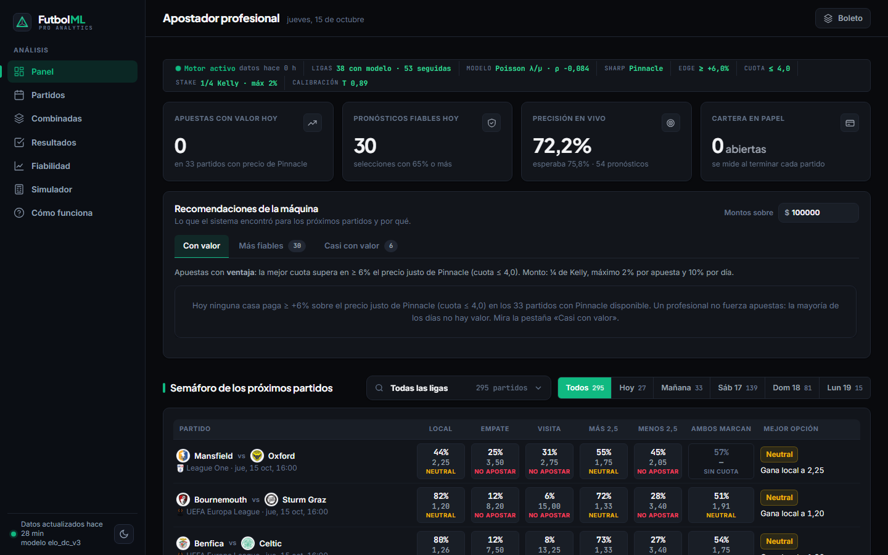
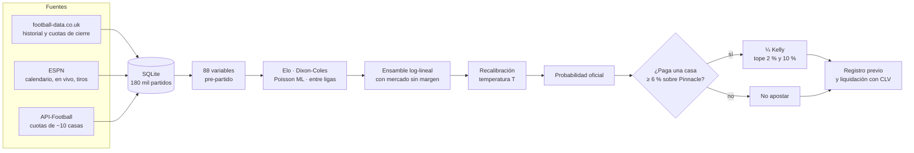
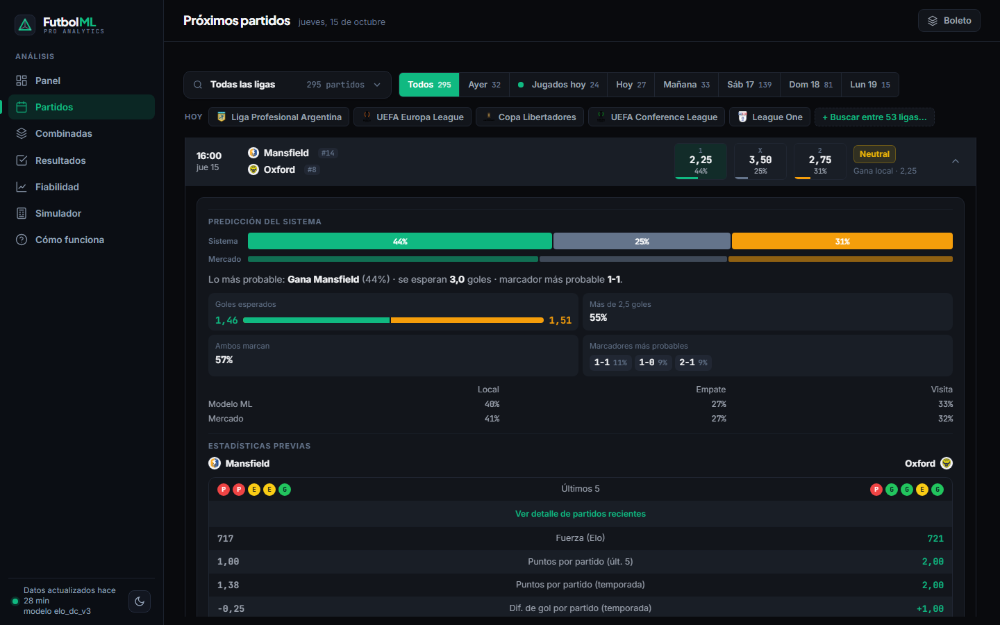

# Futbol ML · Pro Analytics

[](https://github.com/gustavoespi27/Futbol_ML/actions/workflows/ci.yml)


**Motor cuantitativo de probabilidades de fútbol que se audita a sí mismo todos los días.**

Futbol ML estima la probabilidad de cada resultado de un partido en 53 competiciones. Después compara esa
probabilidad con las cuotas de unas 10 casas de apuestas y **registra cada pronóstico antes del inicio**, para
medirlo contra el resultado real. Sobre esa base funciona un *apostador profesional* automatizado. Solo recomienda
apostar cuando una casa paga al menos un 6 % más que el precio justo de Pinnacle, el mercado más eficiente del mundo.

La tesis del proyecto es honesta y medible. **Ganarle al mercado es casi imposible, así que el sistema no lo
promete: lo mide.** Cada número de este documento sale de datos fuera de muestra o de registros hechos antes del
partido.



---

## En cifras

| | |
|---|---|
| **180.407** partidos en la base (2012-2026) | **1,95 millones** de cuotas históricas y pre-partido |
| **53** competiciones seguidas; **38** ligas con modelo validado | **1.725** equipos enlazados entre 3 fuentes de datos |
| **8.608** partidos de examen fuera de muestra (temporada 2026) | **361** partidos auditados en vivo con pronóstico previo |
| Actualización automática **3 veces al día** + cuotas **cada 30 min** | **119** pruebas automáticas, CI en Python 3.11 y 3.12 |

---

## Contenido

- [Por qué es distinto](#por-qué-es-distinto)
- [Hallazgos recientes](#hallazgos-recientes)
- [Resultados](#resultados)
- [Cómo funciona](#cómo-funciona)
- [El apostador profesional](#el-apostador-profesional)
- [Producto: el dashboard](#producto-el-dashboard)
- [Datos e infraestructura](#datos-e-infraestructura)
- [Ingeniería](#ingeniería)
- [Inicio rápido](#inicio-rápido)
- [Arquitectura](#arquitectura)
- [Hoja de ruta](#hoja-de-ruta)
- [Documentación](#documentación)

---

## Por qué es distinto

- **Anclado al mercado más eficiente.** No se apuesta con ventaja calculada solo con modelos propios. El valor existe
  únicamente frente al precio de Pinnacle sin margen. En el histórico, ninguna otra referencia dio un CLV positivo.
- **Auditoría prospectiva.** Toda predicción, pronóstico fiable y apuesta en papel se guarda en la base *antes* del
  inicio del partido. Al terminar se liquida y se mide su CLV (*Closing Line Value*). Nada se reescribe después.
- **Cero filtración de datos.** Cada variable usa solo información conocida antes del inicio del partido. La validación
  es temporal (*walk-forward*) y la temporada 2026 se reserva como examen.
- **Decisiones pre-registradas.** El criterio para elegir ligas, las reglas de apuesta y los umbrales se fijan antes de
  ver el conjunto de prueba. Cada cambio de modelo se adopta solo si mejora el log loss con un intervalo bootstrap del
  95 %.
- **Riesgo controlado.** Se apuesta con ¼ de Kelly, con un tope de 2 % del bankroll por apuesta y de 10 % de
  exposición diaria.

---

## Hallazgos recientes

Los hallazgos de las últimas iteraciones, con su evidencia, están en el
[registro de decisiones](docs/decisiones.md).

### 1. Lo que mejora la precisión es la información, no el modelo

La probabilidad oficial ya es casi la del mercado. En las 38 ligas, la combinación validada le da al mercado un peso de
0,9 a 1,2 y a los modelos propios un peso cercano a 0. Lo que sí mueve la precisión es **qué cuota se usa y cuántos
partidos la tienen**.

- En 18.369 partidos de 2023 a 2026, la cuota de cierre de Pinnacle supera a la de días antes: log loss
  0,9957 vs 0,9989 (−0,0032, IC95 % [−0,0044; −0,0021]).
- **Decisión.** Una tarea cada 30 minutos toma una cuota fresca en las 2 horas previas a cada partido y registra
  el pronóstico final.

### 2. Un modelo entre ligas para las copas internacionales

Elo y Dixon-Coles no comparan clubes de ligas distintas. Para resolverlo se construyó un **Elo global con ajuste de
fuerza por liga**, validado en 1.806 partidos de copa posteriores al entrenamiento:

| Modelo | Log loss | RPS | Acierto |
|---|---:|---:|---:|
| Ingenuo (frecuencias) | 1,0382 | 0,2283 | 49,4 % |
| Elo global | 0,9881 | 0,2103 | 53,7 % |
| **Elo global + ajuste por liga** | **0,9699** | **0,2042** | **54,2 %** |

Gana en las cinco copas (Champions, Europa League, Conference, Libertadores y Sudamericana). Además cuantifica la
distancia entre ligas en puntos Elo: Premier League +209, Bundesliga +145, LaLiga +141, Serie A +124 … Irlanda −190.
Ese mismo modelo alimenta el simulador entre ligas y países.

### 3. Cuotas dañadas que contaminaban la evaluación

El 21 % de las cuotas de Betfair Exchange del calendario de football-data tenía márgenes imposibles, de hasta 171 %.
Betfair era la segunda referencia, así que el 10 % de los pronósticos en vivo se apoyaba en ellas: log loss 1,043
frente a 0,940 del resto.

- **Corrección.** Una casa solo sirve de referencia si su margen está entre −3 % y 15 % y si ninguna de sus
  probabilidades se aleja más de 0,08 del promedio del mercado.

### 4. Señales nuevas: se mide antes de adoptar

| Propuesta | Resultado | Decisión |
|---|---|---|
| Regresión Poisson de λ y μ + matriz de marcadores | 1X2 −0,0020 [−0,0037; −0,0004] | **Adoptada**: 1X2, goles y ambos marcan salen de la misma matriz, coherentes entre sí |
| Proxy de xG en lugar de conteo de tiros | 1X2 +0,0013 (peor) | Descartada: sin ubicación del tiro se pierde información |
| Alineaciones y bajas | 129 partidos con datos de 140 mil | No es viable con el plan gratuito (requiere consultas cerca del inicio) |

### 5. ESPN como fuente gratuita de calendario, marcadores y tiros

API-Football gratuito entrega 100 peticiones al día, y antes cerca de 50 se iban en detalles de partidos.

- **Nueva fuente.** El calendario de 7 días, los resultados, los marcadores en vivo y los tiros pasaron a
  ESPN, sin clave ni cuota, en 48 competiciones.
- **Validación previa.** Antes de adoptarla se probó en una copia de la base: 606 partidos sin duplicados ni
  enlaces erróneos entre homónimos ("River Plate" de Uruguay vs Argentina, "Red Star" de Belgrado vs Francia).
- **Resultado.** Toda la cuota de API-Football queda libre para cuotas.

### 6. La auditoría en vivo, sin maquillaje (al 15-10-2026)

| Métrica en vivo | Valor | Lectura |
|---|---:|---|
| Partidos evaluados con pronóstico previo | 361 | |
| Log loss 1X2 oficial vs mercado (mismos 347 partidos) | 0,9663 vs 0,9622 | El mercado sigue siendo el techo |
| Pronósticos fiables (≥ 65 %): acierto real vs esperado | 72,2 % vs 75,8 % (n = 54) | Diferencia dentro del ruido estadístico (±5,8 pp) |
| Apuestas en papel con valor según el modelo propio | 60 apuestas, CLV −3,0 %, rendimiento −7,4 % | Confirma la regla: **sin Pinnacle no hay ventaja** |
| Recalibración automática | T = 0,894 con 353 partidos | Corrige de a poco la confianza del 1X2 |

---

## Resultados

### Examen fuera de muestra: temporada 2026

8.608 partidos de 1X2 en 38 ligas y 5.302 con cuotas de más/menos goles en 22 ligas, ninguno visto durante el ajuste.

| Mercado y fuente | Acierto | Log loss |
|---|---:|---:|
| 1X2 – probabilidad oficial | 50,6 % | 1,0034 |
| 1X2 – mercado (cierre sin margen) | 50,6 % | 1,0034 |
| 1X2 – ML sobre el historial de los equipos | 49,1 % | 1,0207 |
| 1X2 – Elo + Dixon-Coles | 48,8 % | 1,0237 |
| Más/menos 2,5 – oficial | 57,5 % | 0,6743 |
| Más/menos 2,5 – mercado | 57,8 % | 0,6742 |
| Ambos marcan – ML (frecuencia histórica: 0,6870) | 56,0 % | 0,6830 |

**Calibración.** Cuando el sistema da 60-70 %, ocurre el 65 % de las veces; cuando da 70 % o más, el 77 %. En las
combinadas, el porcentaje anunciado se cumple: 25 % anunciado, 26 % acertadas.

### Apostador profesional en el histórico

La regla se eligió con 2013-2021 y se probó en 2022-2026, sobre cuotas tempranas de 22 ligas europeas
([análisis 06](docs/analisis/06_profesional.md)):

| Período | Apuestas | CLV medio | Superan al cierre | Rendimiento [IC95 %] | Bankroll (inicio 100) |
|---|---:|---:|---:|---|---:|
| Selección 2013-2021 | 419 | +6,8 % | 76 % | +30,0 % [+15 %; +45 %] | 354 |
| Prueba 2022-2026 | 213 | +5,3 % | **77 %** | +2,9 % [−17 %; +23 %] | 122 |

Superar la cuota de cierre 3 de cada 4 veces es la firma de un apostador con ventaja. La ganancia en dinero aún
**no es estadísticamente concluyente**, y por eso todo sigue registrándose en papel.

---

## Cómo funciona



1. **Modelos propios.**
   - *Elo* con multiplicador de goles.
   - *Dixon-Coles* (Poisson bivariado con corrección de marcadores bajos).
   - *Gradient boosting* con pérdida Poisson, que predice los goles esperados del local (λ) y de la visita (μ) a
     partir de 88 variables del historial: forma, tiros, localía, descanso, rachas y enfrentamientos directos.
     Está entrenado con 140 mil partidos.
2. **Probabilidad oficial.** Combina los modelos con el mercado sin margen en un ensamble log-lineal, con pesos no
   negativos ajustados por liga entre 2016 y 2025. Sin cuotas se usa el modelo.
3. **Copas internacionales.** Usan el modelo entre ligas. Cuando hay cuotas, manda Pinnacle sin margen.
4. **Todos los mercados desde una matriz de marcadores.** 1X2, doble oportunidad, más/menos, ambos marcan,
   marcadores exactos y variantes de un mismo partido son coherentes entre sí. Las combinadas respetan la
   correlación dentro de cada partido.
5. **Ajuste automático.** Una temperatura *T*, estimada con los pronósticos registrados antes de cada partido, corrige
   el exceso o la falta de confianza. Se encoge hacia 1 cuando hay pocos datos y se limita a [0,8; 1,25].

---

## El apostador profesional

Implementado en `footy/betting/pro.py`:

1. **Precio justo.** Cuotas 1X2 de Pinnacle sin margen; sin Pinnacle no apuesta.
2. **Line shopping.** Toma la mejor cuota entre Bet365, Betano, 1xBet, William Hill, Marathonbet, BetVictor y otras.
   Pinnacle, los exchanges y los agregadores no cuentan como casas para apostar.
3. **Regla.** Apuesta si `mejor cuota × probabilidad justa − 1 ≥ 6 %` y la cuota es ≤ 4,0. Hace como máximo una
   apuesta por partido: la de mayor crecimiento esperado.
4. **Monto.** ¼ de Kelly, con máximo 2 % del bankroll por apuesta y 10 % por día.
5. **Control.** Registra cada apuesta antes del partido con su motivo y mide su CLV contra el cierre de Pinnacle.

La regla es deliberadamente exigente: **la mayoría de los días no hay apuestas**. Un profesional no fuerza apuestas.

---

## Producto: el dashboard

Es una interfaz web local en español con identidad de terminal de datos deportivos: fondo obsidiana, acento
esmeralda, cifras en JetBrains Mono y tema claro u oscuro. Funciona en el móvil y es accesible por teclado.



| Sección | Contenido |
|---|---|
| **Panel** | Ticker del motor, indicadores del día y recomendador con pestañas *Con valor*, *Más fiables* y *Casi con valor*, cada una con su motivo. Incluye el semáforo de los próximos partidos (1X2, más/menos 2,5 y ambos marcan), la bitácora auditada y la precisión en vivo |
| **Partidos** | Próximos 5 días con filtros por día y por liga. El detalle de cada partido muestra probabilidades del sistema vs mercado, goles esperados, marcadores probables, forma reciente (general y como local o visita), enfrentamientos directos y un comparador de cuotas entre casas con mejor cuota, payout, cuota justa y etiqueta +EV |
| **Ficha de club** | Panel lateral con posición en la tabla, Elo, forma, próximos partidos y promedios de goles y tiros de la temporada |
| **Combinadas** | Constructor con todas las opciones de cada partido y un boleto con probabilidad conjunta exacta, cuota combinada, aviso de correlación y calculadora |
| **Resultados** | Pronósticos registrados vs resultado real, marcadores en vivo cada minuto y apuestas en papel con CLV |
| **Fiabilidad** | Calibración, tabla por liga, modelos de ML e historial de la regla de apuestas |
| **Simulador** | Cualquier cruce, incluso entre ligas y países, con retorno y valor esperado si se ingresan cuotas |

**Rendimiento.** Los cálculos pesados se hacen una sola vez y se comparten entre consultas simultáneas, y los modelos
por liga quedan en caché hasta que hay resultados nuevos. Los recursos estáticos se versionan automáticamente. La API
JSON está documentada en `/api/docs`.

---

## Datos e infraestructura

| Fuente | Uso |
|---|---|
| [football-data.co.uk](https://www.football-data.co.uk/) | Historial desde 2012 de 38 ligas: resultados, tiros y cuotas de cierre (1X2, y más/menos 2,5 en 22 ligas) |
| ESPN (endpoint público) | Calendario de 7 días, resultados, marcadores en vivo y tiros de 48 competiciones, sin cuota diaria |
| [API-Football](https://www.api-football.com/) (plan gratuito) | Cuotas pre-partido de unas 10 casas, incluida Pinnacle, repartidas por prioridad en 100 peticiones al día |

**Ciclo automático.** `scripts/daily.py` corre a las 10:00, 17:30 y 21:15 (hora de Chile). Ingiere los datos,
recalibra, reentrena el modelo entre ligas, predice con ML, registra pronósticos y apuestas, y liquida los partidos
terminados. Si un paso falla, los demás continúan. `scripts/prekickoff.py` corre cada 30 minutos y captura la cuota
final antes de cada partido. Las dos tareas se ejecutan en segundo plano, sin ventanas.

**Enlace de entidades.** Los equipos de las tres fuentes se unen con alias, emparejamiento tolerante por niveles de
confianza y un id externo por club. Cuando aparecen duplicados, se fusionan los equipos y sus partidos.

---

## Ingeniería

- **Backend:** Python 3.11+, pandas, NumPy, SciPy, scikit-learn, SQLite (WAL), FastAPI y Uvicorn.
- **Contratos estrictos:** todas las respuestas pasan por esquemas Pydantic v2 con `extra="forbid"`; un campo nuevo
  sin contrato hace fallar las pruebas.
- **Frontend:** JavaScript sin frameworks ni build, CSS con tokens de diseño y Chart.js.
- **Calidad:** 119 pruebas con pytest, Ruff y CI en GitHub Actions (Python 3.11 y 3.12).
- **Reproducibilidad:** la tarea diaria es idempotente, las fechas se guardan en UTC ISO-8601 y cada pronóstico
  registra la versión del modelo que lo generó.

---

## Inicio rápido

**Requisitos:** Python ≥ 3.11 y una clave gratuita de [API-Football](https://www.api-football.com/).

```bash
python -m venv .venv
.venv\Scripts\activate              # Windows
pip install -r requirements.txt
pip install -e .
copy .env.example .env              # completar API_FOOTBALL_KEY
```

**Primera carga de datos y modelos** (una sola vez):

```bash
python scripts/update_football_data.py          # resultados, estadísticas y cuotas desde 2012
python scripts/backfill_espn.py                 # historial de copas de clubes desde ESPN (modelo entre ligas)
python scripts/build_league_models.py           # pesos y calibración por liga
python scripts/train_ml.py --production         # modelo de ML de producción (~15 min)
```

**Uso diario:**

```bash
python scripts/serve.py                         # dashboard en http://127.0.0.1:8000 (o dashboard.bat)
powershell scripts/register_task.ps1            # tareas automáticas: ciclo diario y cuotas pre-partido
```

**Calidad:**

```bash
pytest
ruff check src scripts tests
```

La clave de API vive solo en `.env`, que no se versiona.

<details>
<summary><b>Todos los scripts</b></summary>

| Script | Descripción |
|---|---|
| `scripts/serve.py` | Dashboard web local |
| `scripts/daily.py` | Ciclo diario completo |
| `scripts/prekickoff.py` | Cuota y pronóstico final en las 2 h previas a cada partido |
| `scripts/register_task.ps1` | Registra las tareas en el Programador de tareas de Windows |
| `scripts/update_football_data.py [CÓDIGOS]` | Descarga o actualiza datos de football-data.co.uk |
| `scripts/backfill_espn.py` | Temporadas e historial de copas desde ESPN |
| `scripts/collect_daily.py` | Solo la recolección de API-Football |
| `scripts/backfill_api_football.py CHL 2022 2023` | Calendario de temporadas pasadas desde API-Football |
| `scripts/backfill_ou_odds.py` | Cuotas de cierre de más/menos 2,5 desde los CSV descargados |
| `scripts/reprocess_api_fixtures.py` | Reprocesa respuestas crudas guardadas sin gastar peticiones |
| `scripts/check_teams.py [--merge A B]` | Detecta y fusiona equipos duplicados entre fuentes |
| `scripts/build_league_models.py` | Pesos, umbrales y calibración por liga (2016-2025) |
| `scripts/train_ml.py [--eval \| --production]` | Entrena y evalúa los modelos de ML |
| `scripts/predict.py --league E0 --home X --away Y` | Predicción de un partido por consola |
| `scripts/analyze_market.py` | Análisis 01: margen y calibración del mercado de cierre |
| `scripts/evaluate_models.py` | Análisis 02: Elo y Dixon-Coles vs mercado |
| `scripts/screen_leagues.py` | Análisis 03: validación en 38 ligas con criterio pre-registrado |
| `scripts/evaluate_shots.py` | Análisis 04: aporte de los tiros |
| `scripts/pro_backtest.py` | Análisis 06: el apostador profesional en el histórico |

</details>

---

## Arquitectura

```
config/            competiciones, fuentes, pesos por liga y alias de equipos
src/footy/
  ingest/          football-data, API-Football, ESPN y orquestador con control de cuota
  db/              esquema SQLite, enlace y fusión de equipos y partidos entre fuentes
  features/        88 variables pre-partido del historial de los equipos
  models/          Elo, Dixon-Coles, ensamble log-lineal, ML Poisson, modelo entre ligas
  markets/         matriz de marcadores → todos los mercados y combinadas
  evaluation/      métricas, walk-forward y evaluación 2026 en vivo
  betting/         margen, apostador profesional (pro.py), semáforo y backtest
  prediction/      predictor por liga, seguimiento, cartera, pronósticos fiables y recalibración
  web/             FastAPI, contratos Pydantic, servicios por responsabilidad y frontend estático
scripts/           puntos de entrada (ciclo diario, cuotas pre-partido, análisis, entrenamiento)
tests/             119 pruebas unitarias
docs/              análisis 01-06 y registro de decisiones
```

---

## Hoja de ruta

- **Muestra de apuestas reales en vivo.** La regla es exigente y aún no se activa en vivo. Hace falta acumular
  apuestas para confirmar el CLV positivo del histórico.
- **Copas: combinar el modelo entre ligas con el mercado,** cuando haya suficientes partidos con cuotas para
  validar los pesos.
- **Alineaciones y bajas.** Es la información que el mercado incorpora y el modelo no. Requiere una fuente
  con consultas cerca del inicio.
- **Movimiento de cuotas.** Hoy se muestra como señal informativa; se incorporará a la regla cuando haya datos
  suficientes para medirlo.

---

## Documentación

| Documento | Tema |
|---|---|
| [01 – Mercado de cierre](docs/analisis/01_mercado_cierre.md) | Margen y calibración de las casas |
| [02 – Modelos](docs/analisis/02_modelos.md) | Elo y Dixon-Coles frente al mercado |
| [03 – Ligas](docs/analisis/03_ligas.md) | Validación en 38 ligas con criterio pre-registrado |
| [04 – Tiros](docs/analisis/04_tiros.md) | Aporte de los tiros al modelo |
| [05 – Machine learning](docs/analisis/05_ml.md) | Modelo sobre el historial de los equipos |
| [06 – Apostador profesional](docs/analisis/06_profesional.md) | Value betting contra Pinnacle y CLV |
| [Decisiones](docs/decisiones.md) | Registro fechado de cada decisión, su evidencia y sus correcciones |

---

> **Aviso.** Proyecto de análisis con fines educativos y de investigación. No es consejo de apuestas ni garantiza
> rentabilidad. La ganancia en dinero aún no es estadísticamente concluyente, las casas limitan a quienes ganan y la
> mayoría de los días no hay apuestas con valor.
