# Fútbol ML · Agente de análisis con IA

[](https://github.com/gustavoespi27/Futbol_ML/actions/workflows/ci.yml)


**Un agente de IA que razona sobre fútbol con datos reales, y un motor estadístico que se audita a sí mismo todos
los días.**

El proyecto tiene dos capas de inteligencia artificial que trabajan juntas:

1. **Un motor cuantitativo** (Elo, Dixon-Coles, *gradient boosting* con pérdida Poisson y un modelo de selecciones)
   que estima la probabilidad de cada resultado en 53 competiciones. Compara esas probabilidades con el mercado
   de apuestas y **registra cada pronóstico antes del partido** para medirlo después contra el resultado real.
2. **Un agente con modelo de lenguaje local** (Qwen 2.5 7B en Ollama) que conversa en español, decide qué consultar,
   cambia de camino según lo que observa, se corrige, recuerda la conversación, crea vigilancias y tiene un vigía
   autónomo que actúa sin que nadie pregunte.

La regla de diseño que une ambas capas: **el LLM decide qué consultar y cómo explicarlo; el motor calcula; los
verificadores controlan.** El modelo de lenguaje nunca inventa una cifra: toda probabilidad, cuota o monto que
muestra sale de una herramienta y pasa por un verificador antes de llegar al usuario.

<p align="center">
  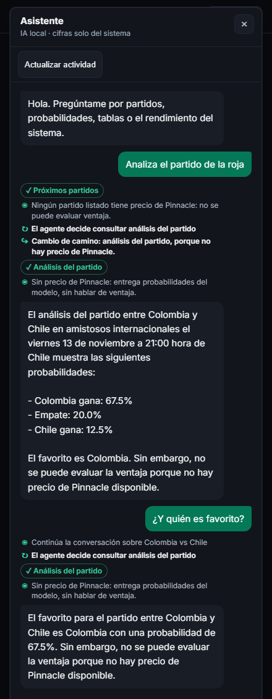
</p>

<p align="center"><sub>Corrida real con Qwen 2.5 7B. «La roja» se resuelve como Chile; al no haber precio de
Pinnacle el agente cambia de camino hacia el análisis del partido; en la pregunta siguiente recuerda de qué partido
se habla y vuelve a consultar en vez de repetir cifras de memoria.</sub></p>

---

## Contenido

- [En cifras](#en-cifras)
- [El agente de IA](#el-agente-de-ia)
- [El motor cuantitativo](#el-motor-cuantitativo)
- [Resultados medidos](#resultados-medidos)
- [Producto: el dashboard](#producto-el-dashboard)
- [Datos, automatización e ingeniería](#datos-automatización-e-ingeniería)
- [Inicio rápido](#inicio-rápido)
- [Arquitectura del código](#arquitectura-del-código)
- [Hoja de ruta](#hoja-de-ruta)
- [Documentación](#documentación)

---

## En cifras

| | |
|---|---|
| **181.114** partidos en la base (2012-2026) | **1,98 millones** de cuotas históricas y pre-partido |
| **53** competiciones visibles, incluidas 8 de selecciones | **1.749** equipos enlazados entre fuentes de datos |
| **8.608** partidos de examen fuera de muestra (temporada 2026) | **498** partidos auditados en vivo con pronóstico previo |
| **16** herramientas del agente (11 de consulta, 4 de acción y 1 de delegación) | **663** pruebas automáticas; CI en Python 3.11 y 3.12 |

---

## El agente de IA

El asistente se llama **El Míster** y habla como director técnico: frases cortas, con autoridad y calma, y la
convicción de que los números mandan, no la camiseta. Entiende cuando le dicen «míster» («míster, ¿cómo llega
Colo Colo?»): el apelativo se quita antes de decidir la consulta. La personalidad vive en un solo módulo
(`footy_agents/persona.py`) y cambia solo el tono: las reglas de cifras, valor y riesgo mandan sobre el estilo. El
saludo o «¿quién eres?» recibe una presentación fija, sin LLM.

Su mascota es un zorro DT, «el zorro del banco», animado como títere de recortes: cada pose está cortada en capas
(cabeza, cuerpo, brazo y cola) que se mueven desde sus articulaciones, con párpados en SVG para parpadear. En el chat
lee la tablet y levanta la vista hacia el usuario (mientras piensa la respuesta sigue leyendo); en el resumen del día
explica con lentes y el dedo en alto; en los avisos toca el silbato y saluda con la pata, y salta cuando llega uno
nuevo. Las capas se generan con `scripts/prepare_mascot.py` y `scripts/rig_mascot.py` desde `assets/mascot/`, y todo
respeta «reducir movimiento».

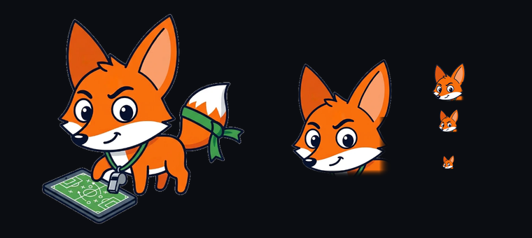

### Tres agentes sobre un tablero compartido

| Agente | Qué decide y hace | Usa LLM |
|---|---|---|
| **El Míster** | Resuelve la pregunta, consulta herramientas y delega `request_odds` si necesita comparar cuotas | Sí, Qwen local |
| **El Ojeador** | Percibe cobertura, agrupa peticiones ESPN por liga y fecha, captura precios y registra descartes | No |
| **El Vigía** | Detecta cambios en el tablero y publica avisos con plantillas verificadas | No |

**DraftKings es precio ofrecido; Pinnacle sin margen es la única referencia de precio justo.**
Sin Pinnacle, el comparador muestra precios y casas, sin calcular ventaja. La delegación reutiliza las
capturas ESPN de menos de una hora; el ciclo general usa una ventana de seis horas, o una si el inicio está a menos de seis.
El presupuesto máximo es de 40 scoreboards por corrida, no una llamada por partido. La bitácora pública queda en
`/api/agent/scout-log`; la decisión de delegar del Míster, en `/api/agent/runs`.
Tras una consulta de cuotas exitosa, el texto calculado se verifica y entrega directamente, sin otra inferencia.

### Qué lo hace un agente y no un chatbot

Un chatbot responde con lo que sabe. Este agente **percibe su entorno, decide, actúa y registra por qué**:

| Capacidad | Cómo se implementa |
|---|---|
| **Percepción tipada** | Cada resultado de herramienta se clasifica (`observations.py`): `ok`, `not_found`, `ambiguous`, `no_pinnacle`, `started`, `stale_data`, `empty`. La observación trae una nota y las acciones válidas para seguir |
| **Decisión y desvío** | No hay un flujo fijo. Si el equipo no aparece, busca el nombre canónico; si falta el precio de Pinnacle, entrega el pronóstico sin hablar de ventaja; si el partido empezó, lo dice. Cada desvío se muestra en el chat con su motivo |
| **Recuperación** | Si el modelo intenta responder sin datos del turno o pedir algo que puede consultar, el orquestador detecta la intención (`routing.py`) y lo obliga a consultar la herramienta correcta |
| **Autocorrección** | Un borrador con cifras sin respaldo o con interpretaciones erróneas (CLV invertido, tope diario confundido con tope por apuesta, conteos de forma) se devuelve al modelo para reescribirlo antes de mostrarse |
| **Memoria** | Decide de forma determinista si una pregunta continúa la conversación. Si continúa, recuerda *qué* partido o equipo se consultó (nunca sus cifras) y vuelve a consultar el dato actualizado |
| **Acción** | Herramientas de escritura: crear, listar y cancelar vigilancias, y agregar favoritos. Solo sobre tablas propias del agente |
| **Autonomía** | Un vigía corre solo después de cada actualización de datos, sin LLM: percibe cambios, decide con reglas, emite alertas y registra hasta las decisiones descartadas |
| **Trazabilidad** | Registro interno de cada turno del chat y de cada ejecución del vigía: herramientas, observaciones, desvíos, reparaciones y motivos. No se muestra en el chat; queda en `/api/agent/runs`, `/api/agent/watch-log` y en la salida de `scripts/agent_watch.py` |
| **Memoria personalizada** | Aprende del usuario sin LLM: su nombre («me llamo…»), lo que dice («soy hincha de Colo Colo», «ya no sigo a…»), los equipos y ligas que consulta y los temas que más pregunta. Vuelve al prompt como contexto y el usuario puede verla y borrarla |
| **Historial** | Conversaciones guardadas como en los asistentes grandes: se retoman con su propio contexto o se borran |

### Cómo piensa: un turno del chat

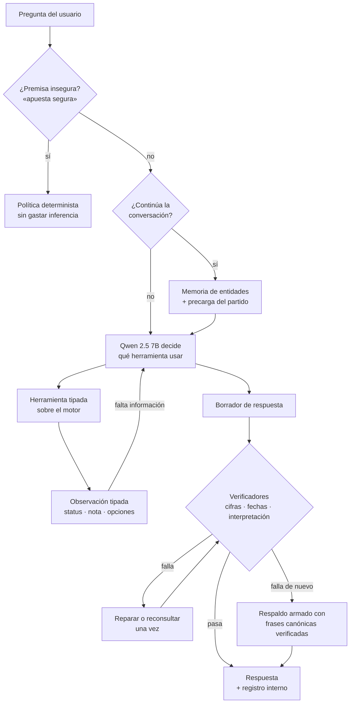

**Herramientas.** Las 16 herramientas validan sus argumentos con Pydantic. `request_odds(match_id)` delega la
captura de precios en el Ojeador y devuelve `comparison_text`, sin convertir DraftKings en referencia:

| Consulta | Acción | Delegación |
|---|---|---|
| `find_team` (nombres y apodos: «la roja», «el cacique») · `analyze_match` · `get_team_form` · `simulate_match` · `get_upcoming_matches` · `get_league_standings` · `get_value_bets` · `get_recommendations` (las tres pestañas de Apuestas) · `get_coverage` · `get_system_performance` · `get_stake_limits` | `create_watch` · `list_watches` · `cancel_watch` · `add_favorite` | `request_odds` (Ojeador y comparador) |

**Protecciones** (*guardrails*):

- **Cifras verificadas.** `verify_numbers` exige que cada número, porcentaje y fecha del texto aparezca en los
  resultados de las herramientas del turno. `check_claims` revisa interpretaciones concretas que el modelo confundía.
- **Frases canónicas.** Las herramientas entregan textos ya interpretados (`summary`, `favorite`, `form_text`,
  `limits_text`, `assessment`, `kickoff_local`) para que el modelo no tenga que convertir horas ni calcular.
- **Respaldo verificado.** Si la redacción falla dos veces, la respuesta se arma solo con esas frases. El chat
  nunca queda en blanco si hubo datos útiles.
- **Límites de costo.** Máximo 4 rondas de herramientas y 384 tokens por inferencia; una sola consulta al LLM a la
  vez. Ollama se inicia solo al usarlo y libera la memoria tras 5 minutos sin uso.
- **Degradación elegante.** Si el LLM no está disponible, el dashboard, el resumen por plantilla y el vigía siguen
  funcionando.

### El vigía autónomo

El vigía (`watcher.py`) se ejecuta al final de cada ciclo de datos (tres veces al día y cada 30 minutos antes de
los partidos) y sigue un ciclo **percibir → comparar → decidir → actuar → registrar**:

- **Percibe** el calendario: precio de Pinnacle, ventaja, probabilidad oficial y hora de inicio.
- **Compara** con su memoria de la ejecución anterior. En la primera percepción solo guarda la línea base, sin
  inventar una transición.
- **Decide** con reglas globales (aparece o desaparece una ventaja, la línea de Pinnacle se mueve ≥ 5 %, un
  partido a menos de 12 h pierde cobertura) y con las vigilancias que el usuario creó desde el chat.
- **Actúa** con avisos deduplicados que expiran al inicio del partido. Solo vuelve a avisar si la ventaja mejora
  al menos 2 puntos.
- **Registra** cada decisión, también las descartadas, con su motivo.

**Avisos en la campana de la barra superior**, fuera del chat:

| Aviso | Cuándo aparece |
|---|---|
| Juega tu equipo | Un equipo o liga favoritos juega en menos de 24 h, con recordatorio a menos de 2 h |
| Cuota con valor | Una casa paga al menos 6 % sobre el precio justo de Pinnacle (seguimiento en papel, tope 2 %) |
| Cerca de tener valor | Le faltan menos de 3 puntos; indica desde qué cuota valdría la pena, sin monto sugerido |
| Combinada con valor | Dos selecciones con valor de partidos distintos; la ventaja se multiplica pierna a pierna |
| Combinada cercana | Dos selecciones con precio de Pinnacle de partidos distintos, ventaja combinada entre 0 y 6 % (informativa, desactivada por defecto) |

Cada tipo se activa o desactiva en Preferencias, con la opción de limitar los avisos de precio a tus equipos y
ligas y de recibir notificaciones del navegador. No usa el LLM: sus textos salen de plantillas verificadas, así que
funciona aunque Ollama esté apagado.

| Avisos (escritorio) | Avisos (móvil) |
|---|---|
| 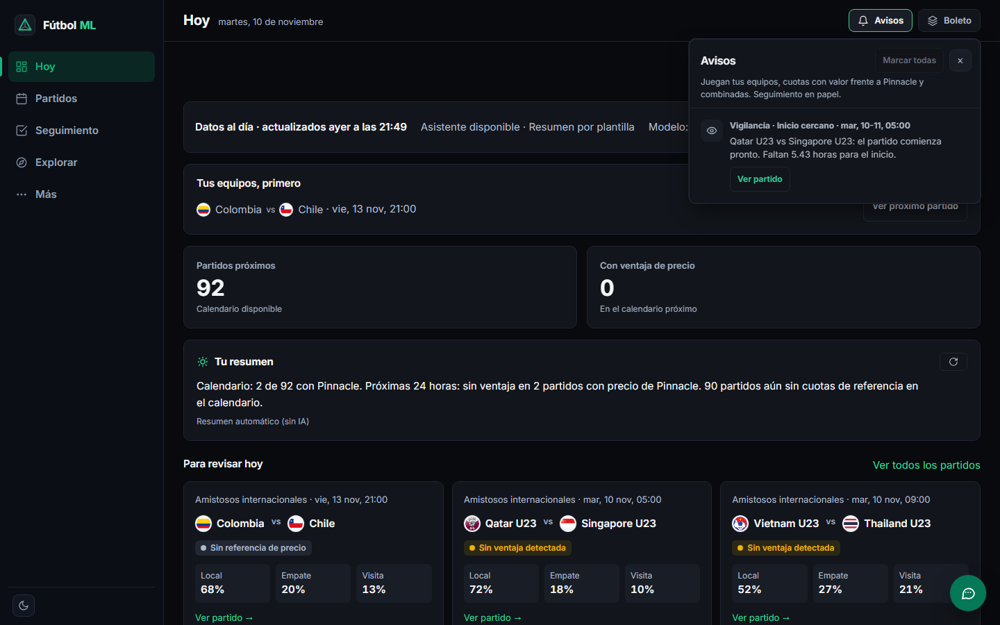 | 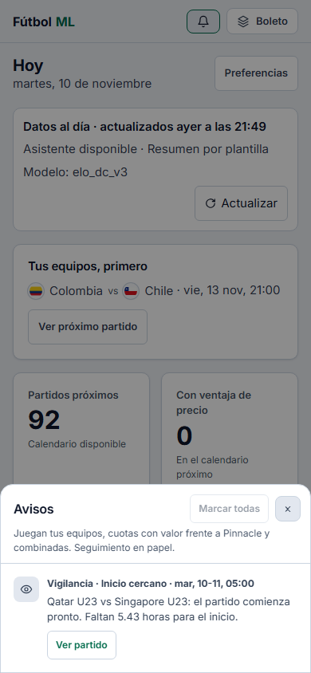 |

### Evaluación del agente

Se evaluó con Qwen 2.5 7B real, consultas secuenciales y revisión manual de cada respuesta
([08 – Capa agéntica](docs/analisis/08_capa_agentica.md)):

| Prueba | Resultado |
|---|---|
| Batería final de 15 turnos (conversación, vigilancias y seguimientos) | **14/15** herramientas y caminos correctos; acciones **3/3** |
| Revisión manual de interpretación | **11** correctas, **3** parciales, **1** sin respuesta |
| Seguimientos con memoria tras el último ajuste | **3/3** correctos, una sola inferencia cada uno |
| Latencia por turno | p50 **10,9 s** · p95 **18,8 s** (GPU de 8 GB) |
| Pruebas automáticas de la capa agéntica | FakeLLM sin red ni tokens; cobertura **96 %** |

**Límites conocidos.** Un modelo de 7B varía entre corridas: puede elegir otra herramienta o redactar una
conclusión imprecisa. Los verificadores controlan cifras e interpretaciones concretas, no el significado general
de cada frase. Por eso el núcleo autónomo (el vigía) es determinista y el chat siempre deja visible qué consultó.
Quince preguntas sirven como evidencia de funcionamiento, no como medida estadística de exactitud.

---

## El motor cuantitativo

### Por qué es distinto

- **Anclado al mercado más eficiente.** El valor solo existe frente al precio de Pinnacle sin margen. En el
  histórico, ninguna otra referencia dio un CLV (*Closing Line Value*) positivo.
- **Auditoría prospectiva.** Toda predicción y apuesta en papel se guarda *antes* del inicio del partido, se liquida
  al terminar y se mide contra el cierre. Nada se reescribe después.
- **Cero filtración de datos.** Cada variable usa solo información anterior al inicio. La validación es temporal
  (*walk-forward*) y la temporada 2026 se reserva como examen.
- **Decisiones pre-registradas.** Un cambio de modelo se adopta solo si mejora el log loss con un intervalo
  bootstrap del 95 %. El [registro de decisiones](docs/decisiones.md) guarda cada una con su evidencia.
- **Riesgo controlado.** ¼ de Kelly, tope de 2 % del bankroll por apuesta y de 10 % de exposición diaria.

### Cómo funciona

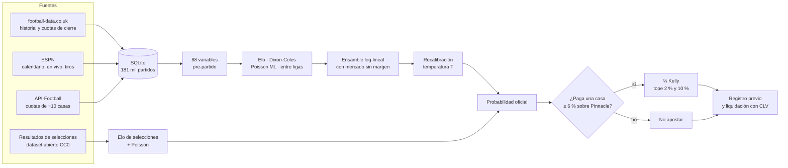

1. **Modelos propios.** *Elo* con multiplicador de goles; *Dixon-Coles* (Poisson bivariado con corrección de
   marcadores bajos); *gradient boosting* con pérdida Poisson que predice los goles esperados de cada equipo a partir
   de 88 variables del historial (forma, tiros, localía, descanso, rachas, enfrentamientos directos), entrenado con
   140 mil partidos.
2. **Probabilidad oficial.** Ensamble log-lineal con pesos no negativos por liga, ajustados entre 2016 y 2025.
3. **Copas de clubes.** Un Elo global con ajuste de fuerza por liga compara clubes de ligas distintas. Validado en
   1.806 partidos de copa: log loss 0,9699 frente a 1,0382 del modelo ingenuo.
4. **Selecciones.** Elo con peso por torneo y localía neutral, más Poisson para goles esperados. Ajustado con
   2000-2021 y probado en **5.068 partidos de 2022-2026: log loss 0,877 frente a 1,050 del ingenuo y 60,2 % de
   acierto** ([11 – Selecciones](docs/analisis/11_selecciones.md)). Se muestra como pronóstico; no se registra en las
   apuestas en papel hasta tener evidencia contra Pinnacle.
5. **Todos los mercados desde una matriz de marcadores.** 1X2, doble oportunidad, más/menos, ambos marcan y
   marcadores exactos son coherentes entre sí; las combinadas respetan la correlación dentro de cada partido.
6. **Ajuste automático.** Una temperatura *T*, estimada con los pronósticos registrados, corrige el exceso o la falta
   de confianza (hoy T = 0,902 con 490 partidos).

### El apostador profesional

Implementado en `footy/betting/pro.py`. Toma el precio justo de Pinnacle sin margen, busca la mejor cuota entre unas
diez casas y apuesta solo si `mejor cuota × probabilidad justa − 1 ≥ 6 %` con cuota ≤ 4,0. Monto: ¼ de Kelly con los
topes de riesgo. Cada apuesta se registra antes del partido con su motivo y se mide su CLV. **La mayoría de los días
no hay apuestas**: un profesional no las fuerza.

---

## Resultados medidos

### Examen fuera de muestra: temporada 2026

8.608 partidos de 1X2 en 38 ligas y 5.302 con cuotas de más/menos goles, ninguno visto durante el ajuste:

| Mercado y fuente | Acierto | Log loss |
|---|---:|---:|
| 1X2 – probabilidad oficial | 50,6 % | 1,0034 |
| 1X2 – mercado (cierre sin margen) | 50,6 % | 1,0034 |
| 1X2 – ML sobre el historial de los equipos | 49,1 % | 1,0207 |
| 1X2 – Elo + Dixon-Coles | 48,8 % | 1,0237 |
| Más/menos 2,5 – oficial | 57,5 % | 0,6743 |
| Ambos marcan – ML (frecuencia histórica: 0,6870) | 56,0 % | 0,6830 |

**Calibración.** Cuando el sistema da 60-70 %, ocurre el 65 % de las veces; cuando da 70 % o más, el 77 %.

### La auditoría en vivo, sin maquillaje

| Métrica en vivo | Valor | Lectura |
|---|---:|---|
| Partidos evaluados con pronóstico previo | 498 | Acierto 1X2: 51,8 % |
| Log loss 1X2 oficial vs mercado (mismos 489 partidos) | 0,9829 vs 0,9667 | **El mercado sigue siendo el techo** |
| Pronósticos fiables (≥ 65 %): acierto real vs esperado | 71,4 % vs 75,6 % (n = 56) | Dentro del ruido estadístico |
| Apuestas en papel con valor según el modelo propio | 60 apuestas · CLV −3,0 % · rendimiento −7,4 % | Confirma la regla: **sin Pinnacle no hay ventaja** |

### Apostador profesional en el histórico

La regla se eligió con 2013-2021 y se probó en 2022-2026, sobre cuotas tempranas de 22 ligas europeas
([06 – Apostador profesional](docs/analisis/06_profesional.md)):

| Período | Apuestas | CLV medio | Superan al cierre | Rendimiento [IC95 %] | Bankroll (inicio 100) |
|---|---:|---:|---:|---|---:|
| Selección 2013-2021 | 419 | +6,8 % | **76 %** | +30,0 % [+14,7 %; +45,3 %] | 354,0 |
| Prueba 2022-2026 | 213 | +5,3 % | **77 %** | +2,9 % [−17,1 %; +22,9 %] | 122,3 |

Superar la cuota de cierre 3 de cada 4 veces es la firma de un apostador con ventaja. La ganancia en dinero aún
**no es estadísticamente concluyente**, y por eso todo sigue registrándose en papel.

---

## Producto: el dashboard

Interfaz web local en español, sin frameworks ni compilación, con tema claro y oscuro, contraste AA, navegación por
teclado y diseño para móvil. Seis destinos: **Hoy, Partidos, Apuestas, Seguimiento, Explorar y Más**, y el asistente siempre
a mano.

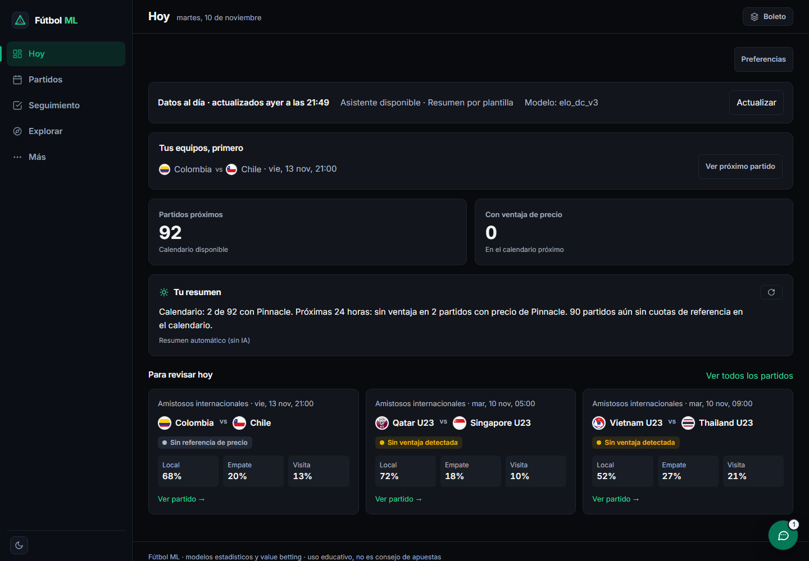

| Sección | Contenido |
|---|---|
| **Hoy** | Franja de estado (frescura de datos, asistente y modelo), tus equipos primero, resumen del día y partidos para revisar con probabilidades compactas |
| **Partidos** | Calendario filtrable por día y liga con probabilidades 1X2, mejor opción y detalle de cada partido: probabilidades, fuente del pronóstico, ventaja de precio, forma, tabla y comparador de cuotas |
| **Apuestas** | Recomendaciones con valor frente a Pinnacle (monto ¼ Kelly sobre tu banca), las más fiables, las que están cerca de tener valor y el semáforo de cada mercado por partido. Accesible desde el menú, desde Hoy y desde Partidos |
| **Seguimiento** | Pronósticos registrados vs resultado real, marcadores en vivo y apuestas en papel con CLV |
| **Explorar** | Simulador de cualquier cruce (incluso entre ligas y países) y constructor de combinadas educativo |
| **Más** | Fiabilidad (calibración, ajuste automático, respaldo histórico), cómo funciona, preferencias y tema |

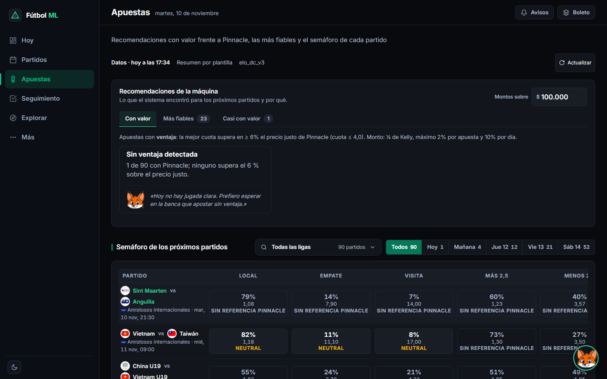

| Partidos | Detalle de un partido |
|---|---|
| 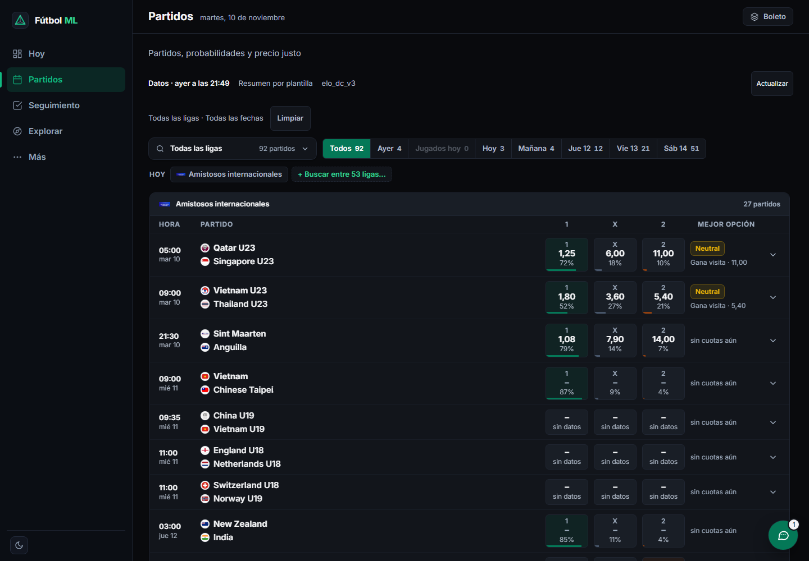 | 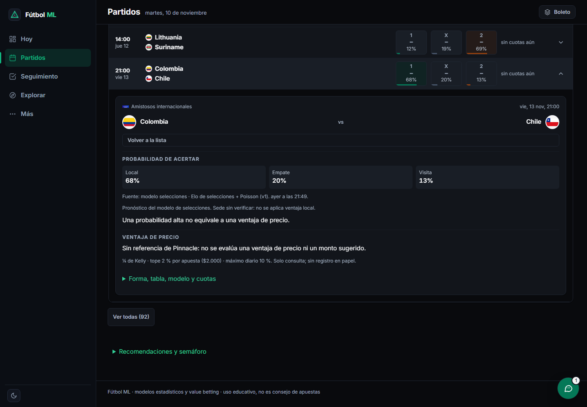 |

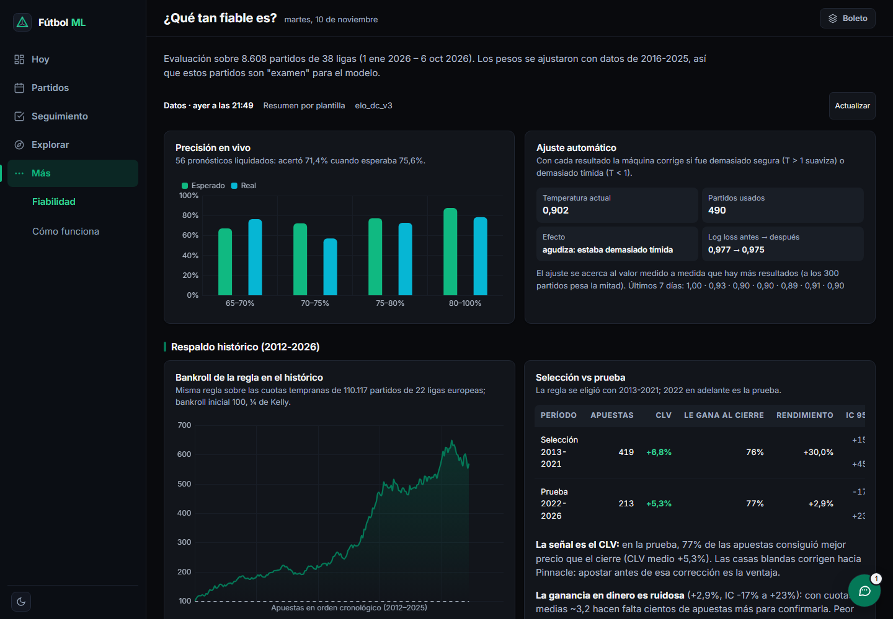

---

## Datos, automatización e ingeniería

| Fuente | Uso |
|---|---|
| [football-data.co.uk](https://www.football-data.co.uk/) | Historial desde 2012 de 38 ligas: resultados, tiros y cuotas de cierre. Descarga condicional con ETag |
| ESPN (endpoint público) | Calendario de 7 días, resultados, marcadores en vivo y tiros, sin cuota diaria |
| [API-Football](https://www.api-football.com/) (plan gratuito) | Cuotas pre-partido de unas 10 casas, incluida Pinnacle, repartidas por prioridad en 100 peticiones al día |
| [Resultados internacionales](https://github.com/martj42/international_results) (CC0) | Historial de selecciones para el modelo de selecciones |

**Ciclo automático.** `scripts/daily.py` corre tres veces al día: ingiere, recalibra, reentrena el modelo entre
ligas, predice, registra pronósticos y apuestas, liquida lo terminado y ejecuta el vigía. `scripts/prekickoff.py`
corre cada 30 minutos y captura la cuota final antes de cada partido. Ambas tareas son **amables con el PC**:
prioridad baja, se difieren si la CPU está ocupada o hay una aplicación a pantalla completa, y omiten cálculos cuando
los datos no cambiaron. `scripts/automation.py` permite pausar y reanudar.

**Ingeniería.**

- **Backend:** Python 3.11+, pandas, NumPy, SciPy, scikit-learn, SQLite (WAL), FastAPI y Uvicorn.
- **Agente sin frameworks:** orquestador propio de ~450 líneas, cliente compatible con OpenAI por `requests` y
  Ollama local. Cambiar de proveedor es cambiar `base_url` y `model` en `config/settings.yaml`.
- **Contratos estrictos:** respuestas y eventos con Pydantic v2 y `extra="forbid"`; el chat usa Server-Sent Events.
- **Calidad:** 663 pruebas con pytest (el agente se prueba con un LLM simulado, sin red ni costo), pruebas del
  frontend con `node:test`, Ruff y CI en GitHub Actions.
- **Reproducibilidad:** fechas en UTC ISO-8601, cada pronóstico registra la versión del modelo, y las evaluaciones
  del agente guardan sus eventos completos en JSON.

---

## Inicio rápido

**Requisitos:** Python ≥ 3.11, una clave gratuita de [API-Football](https://www.api-football.com/) y, para el
asistente, [Ollama](https://ollama.com/) con una GPU de 8 GB o más.

```bash
python -m venv .venv
.venv\Scripts\activate              # Windows
pip install -r requirements.txt
pip install -e .
copy .env.example .env              # completar API_FOOTBALL_KEY
ollama pull qwen2.5:7b              # una vez, para el asistente
```

**Primera carga de datos y modelos** (una sola vez):

```bash
python scripts/update_football_data.py          # resultados, estadísticas y cuotas desde 2012
python scripts/backfill_espn.py                 # historial de copas de clubes desde ESPN
python scripts/build_league_models.py           # pesos y calibración por liga
python scripts/train_ml.py --production         # modelo de ML de producción (~15 min)
```

**Uso diario:**

```bash
python scripts/serve.py                         # dashboard en http://127.0.0.1:8000 (o dashboard.bat)
powershell scripts/register_task.ps1            # tareas automáticas: ciclo diario y cuotas pre-partido
python scripts/agent_watch.py                   # ejecutar el vigía a mano y ver sus decisiones
```

El asistente inicia Ollama solo cuando se le pregunta algo (`agents.llm.autostart: true`). Sin Ollama, todo lo demás
funciona y el resumen del día usa una plantilla.

**Calidad:**

```bash
pytest
ruff check src scripts tests
node --test tests/web/*.cjs
```

La clave de API vive solo en `.env`, que no se versiona.

<details>
<summary><b>Scripts principales</b></summary>

| Script | Descripción |
|---|---|
| `scripts/serve.py` | Dashboard web local |
| `scripts/daily.py` | Ciclo diario completo (ESPN → Ojeador → modelos → Vigía) |
| `scripts/prekickoff.py` | Cuota y pronóstico final en las 2 h previas a cada partido (incluye el vigía) |
| `scripts/odds_scout.py [--dry-run] [--budget 40]` | Percepción, decisiones y captura de cuotas ESPN; simulación sin red ni inserciones |
| `scripts/agent_watch.py` | Ejecuta el vigía y muestra percepción, decisiones y acciones |
| `scripts/automation.py status \| pausa 2h \| reanudar` | Estado y pausa de las tareas automáticas |
| `scripts/register_task.ps1` | Registra las tareas en el Programador de tareas de Windows |
| `scripts/eval_agent_routing.py` | Evaluación del agente con Ollama real (conversación, vigilancias, cierre) |
| `scripts/reset_agent_demo.py [--yes]` | Vacía solo las tablas de demostración del agente |
| `scripts/update_football_data.py [CÓDIGOS]` | Descarga o actualiza datos de football-data.co.uk |
| `scripts/backfill_espn.py` | Temporadas e historial de copas desde ESPN |
| `scripts/check_teams.py [--merge A B]` | Detecta y fusiona equipos duplicados entre fuentes |
| `scripts/build_league_models.py` | Pesos, umbrales y calibración por liga (2016-2025) |
| `scripts/train_ml.py [--eval \| --production]` | Entrena y evalúa los modelos de ML |
| `scripts/eval_international.py` | Evaluación del modelo de selecciones |
| `scripts/pro_backtest.py` | El apostador profesional en el histórico |

</details>

---

## Arquitectura del código

```
config/              competiciones, fuentes, pesos por liga, alias de equipos y configuración del LLM
src/footy/           motor cuantitativo (solo lectura para la capa agéntica)
  ingest/            football-data, API-Football, ESPN, selecciones y orquestador con control de cuota
  db/                esquema SQLite, enlace y fusión de equipos y partidos entre fuentes
  features/          88 variables pre-partido
  models/            Elo, Dixon-Coles, ensamble, ML Poisson, entre ligas y selecciones
  markets/           matriz de marcadores → todos los mercados y combinadas
  evaluation/        métricas, walk-forward y evaluación en vivo
  betting/           margen, apostador profesional, semáforo y backtest
  prediction/        predictor por liga, seguimiento, pronósticos fiables y recalibración
  web/               FastAPI, contratos Pydantic, servicios y frontend estático
src/footy_agents/    capa agéntica, desacoplada del motor
  orchestrator.py    bucle de decisión con herramientas, recuperación, reparación y respaldo
  persona.py         nombre y voz de DT del Míster; apelativo y presentación sin LLM
  observations.py    clasificación tipada de cada resultado de herramienta
  routing.py         continuidad de la conversación e intención para recuperar
  tools.py           16 herramientas tipadas; request_odds delega en el Ojeador
  grounding.py       verificación de cifras, fechas e interpretaciones
  fallback.py        respuesta de respaldo con frases canónicas verificadas
  memory.py          memoria corta, entidades y registro interno de cada turno
  conversations.py   historial de conversaciones: retomar con su contexto o borrar
  user_memory.py     memoria personalizada: equipos, ligas y temas aprendidos del usuario
  odds_scout.py      Ojeador: parser ESPN, percepción, presupuesto, captura y bitácora
  odds_comparison.py comparación directa de SQLite, precio justo solo de Pinnacle
  scout_schemas.py   contratos de percepción, decisiones y bitácora del Ojeador
  watcher.py         vigía autónomo: percibir, comparar, decidir, actuar, registrar
  watches.py         vigilancias y alertas
  notifications.py   avisos: favoritos, cuotas con valor o cerca, combinadas
  llm.py             cliente compatible con OpenAI; ollama_runtime.py lo inicia bajo demanda
  web/router.py      /api/agent: chat y resumen por SSE, conversaciones, memoria, alertas, vigilancias, scout-log, salud
scripts/             puntos de entrada: ciclo diario, cuotas pre-partido, vigía, análisis y evaluación
tests/               663 pruebas; tests/footy_agents usa un LLM simulado
docs/                análisis 01-11, arquitectura del agente, guion de demo y registro de decisiones
```

El detalle de la capa agéntica está en [arquitectura_agente.md](docs/arquitectura_agente.md).

---

## Hoja de ruta

- **Muestra de apuestas reales en vivo.** La regla aún no se activa en vivo; hace falta acumular apuestas para
  confirmar el CLV positivo del histórico.
- **Agente:** evaluar un modelo de lenguaje más grande cuando el hardware lo permita, ampliar la batería de
  evaluación para medir exactitud con significancia y sumar notificaciones fuera del dashboard para las alertas.
- **Selecciones contra el mercado:** compararlas con Pinnacle cuando haya cuotas suficientes de partidos
  internacionales.
- **Alineaciones y bajas.** Es la información que el mercado incorpora y el modelo no.

---

## Documentación

| Documento | Tema |
|---|---|
| [Arquitectura del agente](docs/arquitectura_agente.md) | Componentes, flujo de un turno y del vigía |
| [Guion de demostración](docs/demo_agente.md) | Demo de seis minutos, preparación y plan B |
| [01 – Mercado de cierre](docs/analisis/01_mercado_cierre.md) | Margen y calibración de las casas |
| [02 – Modelos](docs/analisis/02_modelos.md) | Elo y Dixon-Coles frente al mercado |
| [03 – Ligas](docs/analisis/03_ligas.md) | Validación en 38 ligas con criterio pre-registrado |
| [04 – Tiros](docs/analisis/04_tiros.md) | Aporte de los tiros al modelo |
| [05 – Machine learning](docs/analisis/05_ml.md) | Modelo sobre el historial de los equipos |
| [06 – Apostador profesional](docs/analisis/06_profesional.md) | Value betting contra Pinnacle y CLV |
| [07 – Referencia del CLV](docs/analisis/07_clv_referencia.md) | Qué cierre usar para medir el CLV |
| [08 – Capa agéntica](docs/analisis/08_capa_agentica.md) | Diseño, evaluaciones con Ollama y límites del agente |
| [09 – Consumo](docs/analisis/09_consumo.md) | Uso de recursos del PC, Ollama bajo demanda y automatización |
| [10 – Riesgo unificado](docs/analisis/10_riesgo_unificado.md) | Tope de 2 % por apuesta en ambas reglas |
| [11 – Selecciones](docs/analisis/11_selecciones.md) | Modelo de selecciones y su evaluación |
| [Decisiones](docs/decisiones.md) | Registro fechado de cada decisión, su evidencia y sus correcciones |

---

> **Aviso.** Proyecto de análisis con fines educativos y de investigación. No es consejo de apuestas ni garantiza
> rentabilidad. La ganancia en dinero aún no es estadísticamente concluyente y la mayoría de los días no hay
> apuestas con valor.
