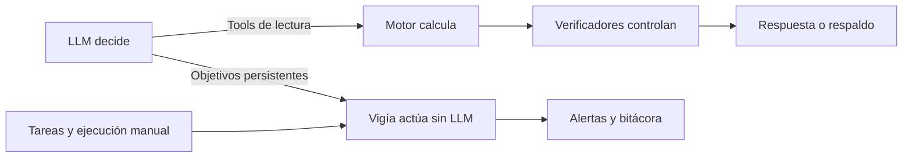
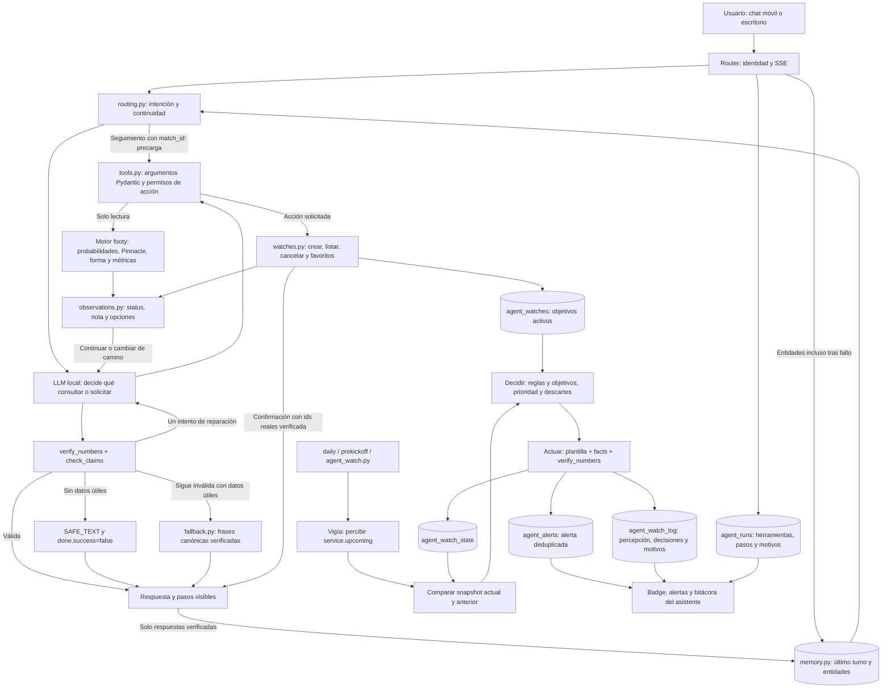
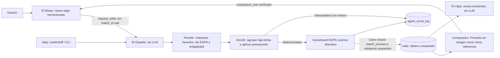

# Arquitectura del agente

El LLM elige herramientas y redacta. El motor calcula las cifras. Los verificadores comprueban
procedencia numérica y algunas confusiones conocidas. El vigía persigue los objetivos sin usar un LLM.

## Resumen para la presentación

## Mapa operativo

El diagrama separa dos ciclos:

- **Conversación:** el modelo decide dentro de las herramientas permitidas. Una escritura requiere
  intención explícita; crear una vigilancia exige identificar el objetivo. La confirmación usa el id
  persistido. La memoria conserva identidades aun tras un fallo, y solo recuerda respuestas verificadas.
  Un seguimiento con match_id consulta el análisis actualizado antes de la primera inferencia; ese
  resultado alimenta también el respaldo si la redacción no supera la verificación.
- **Vigía:** compara datos actuales con su memoria y los objetivos. Registra también decisiones de no
  actuar. Una transacción publica estado, alerta y objetivo cumplido; repetir el mismo ciclo no duplica
  alertas. Los textos son plantillas verificadas y nunca inicia ni consulta Ollama.

El motor y sus tablas permanecen fuera del alcance de escritura del agente. Las acciones afectan
únicamente `agent_*`; agregar favoritos modifica `agent_user_preferences`. El reset de demo admite
solo seis tablas y conserva preferencias. No hay órdenes de apuestas ni escrituras en `pro_bets`.

El respaldo necesita resultados útiles ya consultados. Los verificadores no demuestran corrección
semántica general: el modelo todavía puede elegir mal una herramienta, omitir una consulta o redactar
mal la cobertura. La bitácora permite distinguir estas situaciones de una respuesta válida y del
respaldo determinista.

Código: [orquestador](../src/footy_agents/orchestrator.py), [ruteo](../src/footy_agents/routing.py),
[observaciones](../src/footy_agents/observations.py), [memoria](../src/footy_agents/memory.py),
[respaldo](../src/footy_agents/fallback.py), [vigía](../src/footy_agents/watcher.py),
[persistencia](../src/footy_agents/watches.py). Evidencia y límites en
[08_capa_agentica.md](analisis/08_capa_agentica.md).

## Ojeador: delegación y tablero de cuotas

El Ojeador no consulta API-Football: registra que queda reservada para la ingesta diaria. La respuesta del
comparador usa su texto canónico completo o reparación/respaldo. Las casas publicadas por `espn_odds` se
excluyen de las referencias 1X2 y OU del contexto web; conservan su función de precio ofrecido para el motor profesional.
La revisión de datos se publica tras una inserción real y el panel recibe el refresco público. Una base temporal
no toca los cachés globales ni hace ese POST. `--dry-run` no consulta ESPN ni escribe la bitácora.
